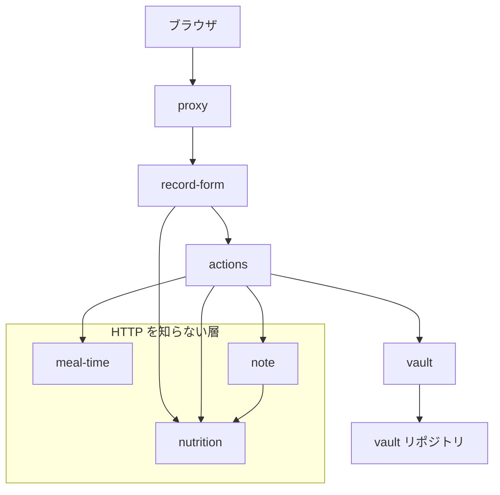
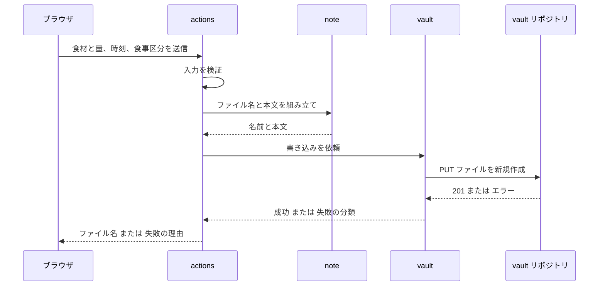

# Design Document

## Overview

**Purpose**: 外出先のスマホから食事を記録し、vault に 1 食 1 ファイルの Markdown を置く。利用者は食材の名前と 100g あたりの概算値、食べた量を入力し、カロリーとタンパク質の掛け算は自分で行わない。

**Users**: 利用者本人ひとり。開発者と同一人物である。

**Impact**: `app-foundation` が用意した土台の上に、初めて機能を載せる。雛形ページを記録画面に置き換え、`src/lib/` に純粋関数を 3 つ、`src/app/` に Server Action と画面を追加する。アプリが外部へ書き込みを行うようになるため、書き込み用の資格情報を環境変数に追加する。

**データを貯めない**: アプリは食材のデータもプリセットも保持しない。記録のたびに入力を受ける。貯める仕組みと栄養価の推定は後続の spec が扱う。

### Goals

- 食材を入力して送信すると、vault に正しい形の Markdown が 1 つ置かれる
- カロリーとタンパク質を、入力された 100g あたりの値と量から算出する
- 記録できたかどうかがその場で分かり、失敗しても入力が失われない
- 書き込み用の資格情報を利用者の端末に渡さない

### Non-Goals

- **プリセット**。食材のデータを貯める仕組みを一切持たない
- **栄養価の推定**。100g あたりの値は利用者が調べて入力する
- 食材名の正規化。入力された文字列をそのまま使う
- 献立単位の記録。食材単位のみ
- 集計・サマリーの更新。Obsidian の Bases と Dataview が担う
- 記録した内容の一覧表示と検索
- 写真からの推定
- 既存ファイルの更新。書き込みは常に新規作成

初期リリースの入力は手間がかかる。それを承知のうえで、**まず記録が vault に届く経路を通すこと**を優先する。使ってみて初めて、何を自動化すべきかが具体的に分かる。

## Boundary Commitments

### This Spec Owns

- 入力された 100g あたりの値と量から導くカロリーとタンパク質の算出、丸め、合計
- 時刻から食事区分を推定する規則
- vault に置く Markdown の形（ファイル名・frontmatter・本文）
- vault への書き込みの実行と、その結果の分類
- 記録画面と送信の受付

### Out of Boundary

- **アクセス制御の仕組み**。Basic 認証の判定も遮断点も `app-foundation` が持つ。本 spec は既存の判定関数を**呼ぶ**だけで、認証方式を定義しない
- **食材のデータを貯めること**。プリセットの保持・登録・選択はすべて後続の spec。**アプリは記録のたびに入力を受けるだけで、何も覚えない**
- **栄養価の推定**。食材名から 100g あたりの値を出す仕組みは後続の spec。本 spec では利用者が調べて入力する
- **vault の同期**。obsidian-git が担う。記録の完了は**vault への書き込みが終わった時点**で判断する
- **集計**。日次・月次の合計は Obsidian 側が算出する。アプリは合計を保存しない
- **`Meals/presets.md` の読み取り**。読み取り経路そのものを作らない（`tech.md`）
- **配置作業**。Vercel への環境変数の設定とデプロイ

### Allowed Dependencies

- `app-foundation` が導入した構成（Next.js 16 / React 19 / TypeScript 5 / Tailwind v4 / Biome / Vitest）
- GitHub Contents API — vault への書き込み。**書き込みのみ。読み取りには使わない**
- `app-foundation` の `basic-auth` — 多層防御として Server Action から認証を検証する。既存の `loadCredentials` / `verifyCredentials` を呼ぶだけで、変更しない
- Node.js 標準モジュール（`node:buffer` の Base64 エンコード）
- **実行時依存は追加しない。** GitHub API の呼び出しは `fetch` で行い、SDK を導入しない

### Revalidation Triggers

- **vault のファイル形式を変更したとき** — Obsidian 側の Bases / Dataview のクエリが成り立たなくなる
- **環境変数の名称を変更したとき** — 配置環境の設定と齟齬が生じ、記録できなくなる
- **食材のデータを貯める仕組みを入れたとき** — 読み取り経路が生まれ、「書き込みのみ」という依存の制約が崩れる。栄養価の推定を入れる場合も同様に外部への問い合わせが増える
- **遮断点の `matcher` を変更したとき** — Server Action への POST が保護から外れうる（`app-foundation` の申し送り）
- **丸めの規則を変更したとき** — 過去の記録と新しい記録で数値の意味が変わり、月次の比較が成り立たなくなる
- **外部 API の応答の分類が変わったとき** — 重複を 422 で判定している。GitHub が検証の分類を変えると、重複以外の 422 を重複と誤判定する

## Architecture

### Existing Architecture Analysis

`app-foundation` が次の構造を確立している。本 spec はこれを変更しない。

- **単一の関門**: `src/proxy.ts` が全要求を遮断する。除外は manifest とアイコンのみ
- **HTTP を知らない純粋関数**: `src/lib/basic-auth.ts` が `Request` にも `Response` にも依存せず、文字列を受けて真偽値を返す
- **実行時依存ゼロ**: `dependencies` は `next` / `react` / `react-dom` のみ

本 spec は 2 番目のパターンを踏襲する。算出・推定・生成を純粋関数に分け、外部との通信と配線だけを別の層に置く。

### Architecture Pattern & Boundary Map



**Architecture Integration**:

- **選択したパターン**: Server Action を配線に徹させ、判断と生成を純粋関数に分離する。層と呼べる構造は持たない
- **境界の分け方**: 「外部と通信する層（`vault`）」「配線する層（`actions`）」「何も知らない層（`nutrition` / `meal-time` / `note`）」の 3 つ。後者は `fetch` にも `FormData` にも依存しない
- **既存パターンの維持**: サーバーコンポーネント既定、`@/` エイリアス、App Router のファイル規約を変更しない
- **新規要素の根拠**: 純粋関数を分けるのは、単体テストを HTTP の組み立てなしに書けるようにするため。`app-foundation` の `basic-auth` が同じ構造で成立した

**依存の方向**: `types` → `nutrition` / `meal-time` → `note` → `vault` → `actions` → UI。各層は左側のみを import する。**逆向きの import は誤りとして扱う。**

`record-form` が `nutrition` を直接 import するのは、合計をその場で表示するためである。サーバー側と同じ関数を通すので、**画面に出る数字と vault に書かれる数字が一致する。**

### Technology Stack

| Layer | Choice / Version | Role in Feature | Notes |
|-------|------------------|-----------------|-------|
| Frontend | React 19 の `useActionState` | 送信中の状態と結果の保持 | `[state, formAction, pending]` を返す。`pending` が受入基準 6.1 を担う |
| Backend | Next.js 16 の Server Action | フォームの受付と配線 | `'use server'`。資格情報はこの中でのみ読む |
| Data / Storage | GitHub Contents API | vault への書き込み | `PUT /repos/{owner}/{repo}/contents/{path}`。**書き込みのみ** |
| Infrastructure | Vercel の環境変数 | 資格情報の保持 | 配置作業は本 spec の対象外 |

新規の実行時依存はゼロ。GitHub API は `fetch` で呼ぶ。

## File Structure Plan

### Directory Structure

```
src/
├── lib/
│   ├── types.ts             食材・記録・結果の型。他のモジュールが参照する
│   ├── nutrition.ts         入力値から栄養価を算出し、丸めて合計する
│   ├── nutrition.test.ts
│   ├── meal-time.ts         時刻から食事区分を推定する
│   ├── meal-time.test.ts
│   ├── note.ts              ファイル名と Markdown を組み立てる
│   ├── note.test.ts
│   └── vault.ts             vault への書き込み。GitHub Contents API を呼ぶ
└── app/
    ├── actions.ts           Server Action。入力を受けて記録する
    ├── actions.test.ts      入力の検証のみを対象にする
    ├── record-form.tsx      記録フォーム。クライアントコンポーネント
    └── page.tsx             記録画面。フォームを置くだけ
```

`actions.test.ts` が対象にするのは**入力の検証だけ**である。食材が 0 件、数値として解釈できない値、名前が空といった入力は、外部 API にもフレームワークのランタイムにも触れずに弾かれるため、テストから確かめられる。成功経路は `headers()` と外部への通信を含むため、手作業の確認で担保する。

食材のデータを持つファイルは置かない。**アプリは何も覚えない。**

`vault.ts` に対応するテストファイルは置かない。外部 API への通信を含むため、単体テストでは意味のある検証ができない。実測で担保する（Testing Strategy を参照）。

### Modified Files

- `src/app/page.tsx` — `create-next-app` の雛形を記録画面に置き換える
- `.env.local.example` — vault への書き込みに必要な環境変数を追記する。値は含めない

## System Flows



**Key Decisions**:

- 存在チェックを行わない。衝突は API のエラー応答として現れる。したがって**その応答を重複と判定できることが前提**になる（未検証。Open Questions を参照）
- 資格情報は Server Action の中でのみ読む。ブラウザには結果だけを返す
- 失敗しても入力はクライアント側の状態として残る。Server Action は結果だけを返し、入力を破棄しない

## Requirements Traceability

| Requirement | Summary | Components | Interfaces | Flows |
|-------------|---------|------------|------------|-------|
| 1.1 | 入力する手段を示す | 記録フォーム | フォームの項目 | — |
| 1.2, 1.3, 1.4 | 対象に加える・複数・取り消す | 記録フォーム | フォームの状態 | — |
| 1.5 | 名前が空なら加えない | 記録フォーム / 記録の受付 | 入力の検証 | — |
| 1.6 | 対象が無いときは送信しない | 記録フォーム / 記録の受付 | 送信ボタンの無効化 / `invalid` | 記録フロー |
| 2.1 | 入力の変更で算出し直す | 栄養価の算出 | `calculateItem` | — |
| 2.2 | 合計を示す | 栄養価の算出 | `sumNutrition` | — |
| 2.3, 2.4 | 食材ごとに丸め、合計はその和 | 栄養価の算出 | `calculateItem` / `sumNutrition` | — |
| 2.5 | 単位を伴わない数値 | ノートの生成 | `buildNote` | — |
| 2.6 | 不正な数値を弾く | 記録フォーム / 記録の受付 | 入力の検証 | 記録フロー |
| 3.1 | 現在時刻を既定値にする | 記録フォーム | フォームの初期値 | — |
| 3.2, 3.3 | 時刻から区分を推定する | 食事区分の推定 | `estimateMealKind` | — |
| 3.4 | 自ら選んだ区分を保持する | 記録フォーム | フォームの状態 | — |
| 3.5 | 分の単位まで扱う | ノートの生成 | `buildFileName` | — |
| 4.1 | 新規ファイルを 1 つ作る | vault への書き込み | `writeNote` | 記録フロー |
| 4.2 | ファイル名は時刻から決める | ノートの生成 | `buildFileName` | — |
| 4.3 | frontmatter に 8 項目 | ノートの生成 | `buildNote` | — |
| 4.4 | 量つきサマリーを組み立てる | ノートの生成 | `buildNote` | — |
| 4.5 | 食材名のリストは量を含まない | ノートの生成 | `buildNote` | — |
| 4.6 | 本文に内訳を書く | ノートの生成 | `buildNote` | — |
| 4.7 | 料理名は任意 | ノートの生成 | `buildNote` | — |
| 4.8 | 重複なら記録せず示す | vault への書き込み | `WriteResult` の `duplicate` | 記録フロー |
| 4.9 | 既存を読まない・統合しない | vault への書き込み | `sha` を送らない | 記録フロー |
| 5.1 | 送信中の表示と二重送信の防止 | 記録フォーム | `useActionState` の `pending` | — |
| 5.2 | 成功とファイル名を示す | 記録の受付 / 記録フォーム | `RecordState` | 記録フロー |
| 5.3 | 失敗の原因を 3 つに分ける | vault への書き込み / 記録の受付 | `WriteResult` / `RecordState` | 記録フロー |
| 5.4 | 入力を保持する | 記録フォーム | クライアント側の状態 | — |
| 6.1 | 資格情報をリポジトリに含めない | vault への書き込み | 環境変数 | — |
| 6.2 | 資格情報を端末に渡さない | 記録の受付 / vault への書き込み | Server Action の境界 | 記録フロー |
| 6.3 | 未設定なら記録を試みない | vault への書き込み | `loadVaultConfig` が `null` | 記録フロー |

33 の受入基準すべてに担当が割り当たっている。

## Components and Interfaces

| Component | Domain/Layer | Intent | Req Coverage | Key Dependencies | Contracts |
|-----------|--------------|--------|--------------|------------------|-----------|
| 栄養価の算出 | ドメイン | 入力値から栄養価を出し、丸めて合計する | 2.1〜2.4 | なし | Service |
| 食事区分の推定 | ドメイン | 時刻から区分を決める | 3.2, 3.3 | なし | Service |
| ノートの生成 | ドメイン | ファイル名と Markdown を組み立てる | 2.5, 3.5, 4.2〜4.7 | 栄養価の算出 (P0) | Service |
| vault への書き込み | 外部連携 | vault にファイルを作る | 4.1, 4.8, 4.9, 6.1, 6.3 | GitHub Contents API (P0) | Service |
| 記録の受付 | ランタイム | 入力を受けて配線する | 1.5, 1.6, 2.6, 5.2, 5.3, 6.2 | 上記すべて (P0) | Service |
| 記録フォーム | UI | 入力・取り消し・送信 | 1.1〜1.6, 2.2, 2.6, 3.1, 3.4, 5.1, 5.4 | 記録の受付 (P0), 栄養価の算出 (P0) | — |
| 記録画面 | UI | フォームを配置する | — | 記録フォーム (P0) | — |

### 型

```typescript
/** 利用者が入力した食材。100g あたりの概算値も量も入力値である。 */
export type FoodInput = {
  readonly name: string;
  readonly kcalPer100g: number;
  readonly proteinPer100g: number;
  readonly grams: number;
};

/** 記録の対象に加えた食材。量が決まり、栄養価は整数に丸められている。 */
export type MealItem = {
  readonly name: string;
  readonly grams: number;
  readonly kcal: number;
  readonly protein: number;
};

/** 食事区分。 */
export type MealKind = "朝" | "昼" | "夜" | "間食" | "寝る前";

/** 記録 1 件の内容。 */
export type MealRecord = {
  readonly eatenAt: Date;
  readonly kind: MealKind;
  readonly dish: string | null;
  readonly items: readonly MealItem[];
};
```

`MealKind` を文字列リテラルの合併にするのは、vault に書く値がそのまま Obsidian の絞り込みに使われるためである。表記を型で固定する。

### ドメイン層

#### 栄養価の算出

| Field | Detail |
|-------|--------|
| Intent | 入力された 100g あたりの値と量から栄養価を出し、整数に丸めて合計する |
| Requirements | 2.1, 2.2, 2.3, 2.4 |

**Responsibilities & Constraints**

- HTTP も `FormData` も参照しない。値を受けて値を返す
- **丸めは食材ごとに行う。** 合計は丸めた値の和とする（2.3, 2.4）
- 丸めは四捨五入とする

**Dependencies**

- Inbound: 記録の受付、ノートの生成、記録フォーム（P0）

**Contracts**: Service [x]

##### Service Interface

```typescript
/** 入力された 100g あたりの値と量から、整数に丸めた栄養価を出す。 */
export function calculateItem(input: FoodInput): MealItem;

/** 丸めた食材ごとの値を合計する。 */
export function sumNutrition(items: readonly MealItem[]): {
  readonly kcal: number;
  readonly protein: number;
};
```

- **Preconditions**: `input.grams` / `kcalPer100g` / `proteinPer100g` はいずれも 0 以上の有限な数
- **Postconditions**: `calculateItem` が返す `kcal` と `protein` は整数。`sumNutrition` の結果は引数の各値の和に等しい
- **Invariants**: 同じ入力に対して常に同じ結果を返す

**Implementation Notes**

- Integration: 記録フォームが合計の表示に使い、ノートの生成が frontmatter の値に使う。**同じ関数を通すことで、画面に出る数字と vault に書かれる数字が一致する**
- Validation: 本文に並べた数字を足せば frontmatter の合計になる。この関係を単体テストで確かめる
- Risks: 丸めを食材ごとに行うため、食材が多いと誤差が積み上がる。「精度より継続」の方針で許容する

#### 食事区分の推定

| Field | Detail |
|-------|--------|
| Intent | 時刻から食事区分を決める |
| Requirements | 3.2, 3.3 |

**Responsibilities & Constraints**

- 時刻だけを見る。利用者の指定を知らない。指定を優先する判断は記録フォームが持つ（3.4）
- **5 つの区分すべてを返す。** 利用者の生活では 16 時台の間食（シリアル）が定着しているため、間食も時刻から推定できる

**Contracts**: Service [x]

##### Service Interface

```typescript
/** 時刻から食事区分を推定する。 */
export function estimateMealKind(eatenAt: Date): MealKind;
```

- **Postconditions**: 返す値は時刻の時間帯によって次のとおり定まる

  | 時間帯 | 区分 | 根拠となる習慣 |
  |---|---|---|
  | 05:00–11:59 | 朝 | 9:30–10:30 |
  | 12:00–15:59 | 昼 | 13:00–14:00 |
  | 16:00–18:59 | 間食 | 16 時ごろのシリアル |
  | 19:00–22:59 | 夜 | 20:00–21:00 |
  | 23:00–04:59 | 寝る前 | 23:00–24:00 のバナナとプロテイン |

- **Invariants**: すべての時刻に対して値を返す。例外を投げない

**Implementation Notes**

- Integration: 記録フォームが初期表示と時刻変更時に呼ぶ
- Validation: 各境界（4:59 / 5:00 / 11:59 / 12:00 / 15:59 / 16:00 / 18:59 / 19:00 / 22:59 / 23:00）を単体テストで確かめる
- Integration: 区切りは利用者の食事の時間から引いた。**普段の 5 食がいずれも手直し不要になる**ように配置してある
- Risks: 生活が変わると推定が合わなくなる。その場合は境界の数値を変えるだけで済む。区分そのものを増減する変更は vault の既存ノートと整合しなくなるため、Revalidation Triggers に該当する

#### ノートの生成

| Field | Detail |
|-------|--------|
| Intent | 記録からファイル名と Markdown を組み立てる |
| Requirements | 2.5, 3.5, 4.2, 4.3, 4.4, 4.5, 4.6, 4.7 |

**Responsibilities & Constraints**

- 文字列を組み立てるだけ。書き込みは行わない
- frontmatter の 8 項目をすべて出力する。料理名が無い場合の扱いは下記 Postconditions に定める
- 数値に単位を付けない（2.5）

**Dependencies**

- Inbound: 記録の受付（P0）
- Outbound: 栄養価の算出 — 合計の算出（P0）

**Contracts**: Service [x]

##### Service Interface

```typescript
/** 記録からファイル名を決める。拡張子を含む。 */
export function buildFileName(record: MealRecord): string;

/** 記録から Markdown の全文を組み立てる。 */
export function buildNote(record: MealRecord): string;
```

- **Preconditions**: `record.items` は 1 件以上
- **Postconditions**:
  - `buildFileName` は `YYYY-MM-DD-HHmm.md` の形式を返す（4.2, 3.5）
  - `buildNote` の frontmatter は `date` / `time` / `meal` / `menu` / `kcal` / `protein` / `foods` / `dish` を持つ
  - `menu` は `白米300g / 鶏もも400g` のように食材名と量を並べた文字列（4.4）
  - `foods` は量を含まない名前の配列（4.5）
  - 本文は食材ごとに `- 白米 300g — 468 / P8` の形で並べる（4.6）
  - 料理名が無い場合、`dish` の値を空にして行は出力する（4.7）
- **Invariants**: frontmatter は常に 8 項目をすべて持つ。本文に並べた数値の和が frontmatter の `kcal` / `protein` に等しい

**Implementation Notes**

- Integration: 時刻の整形はローカルタイムで行う。vault は日本時間の生活記録であり、UTC で書くと日付がずれる
- Validation: frontmatter の 8 項目、`menu` と `foods` の違い、本文と合計の一致、料理名を省略したときに `dish` が空で出ることを単体テストで確かめる
- Integration: **料理名が無くても `dish` の行は出す。** 8 項目が常に揃うため、Obsidian 側で「プロパティが無いノート」を考慮しなくて済む。寝る前のバナナやプロテインのように料理名を持たない記録が多いため、ここが揃っているほうが一覧が安定する

### 外部連携層

#### vault への書き込み

| Field | Detail |
|-------|--------|
| Intent | vault にファイルを新規作成し、結果を分類して返す |
| Requirements | 4.1, 4.8, 4.9, 6.1, 6.3 |

**Responsibilities & Constraints**

- **`sha` を送らない。** 既存ファイルの取得も行わない（4.9）
- 例外を投げない。失敗は戻り値で表す
- 資格情報を戻り値に含めない。ログにも出さない

**Dependencies**

- Inbound: 記録の受付（P0）
- External: GitHub Contents API — ファイルの作成（P0）

**Contracts**: Service [x]

##### Service Interface

```typescript
/** vault の所在と資格情報。 */
export type VaultConfig = {
  readonly owner: string;
  readonly repo: string;
  readonly token: string;
};

/** 環境変数から設定を読み出す。すべて揃っていなければ null。 */
export function loadVaultConfig(
  env: Record<string, string | undefined>,
): VaultConfig | null;

/** 書き込みの結果。失敗の理由は受入基準 5.3 の 3 分類に対応する。 */
export type WriteResult =
  | { readonly ok: true; readonly fileName: string }
  | { readonly ok: false; readonly reason: "duplicate" | "permission" | "network" };

/** vault にファイルを新規作成する。例外は投げない。 */
export function writeNote(
  config: VaultConfig,
  fileName: string,
  body: string,
): Promise<WriteResult>;
```

- **Preconditions**: `config` は `loadVaultConfig` が `null` 以外を返した値
- **Postconditions**:
  - 作成に成功した場合のみ `ok: true` を返す
  - 同じ名前のファイルが既にある場合は `reason: "duplicate"` を返す（4.8）
  - 資格情報が受け付けられない場合は `reason: "permission"` を返す
  - 通信に失敗した場合は `reason: "network"` を返す
- **Invariants**: 戻り値に資格情報を含めない。例外を投げない

##### API Contract

| Method | Endpoint | Request | Response | Errors |
|--------|----------|---------|----------|--------|
| PUT | `/repos/{owner}/{repo}/contents/Meals/items/{fileName}` | `{ message, content }` | 201 Created | 401 / 403 → `permission`、422 → `duplicate`、その他 → `network` |

- `content` は Markdown 全文を **Base64 エンコード**した文字列
- `message` はコミットメッセージ。ファイル名を含める
- ヘッダに `Authorization: Bearer <token>`、`Accept: application/vnd.github+json`、`X-GitHub-Api-Version: 2022-11-28` を付ける
- **`sha` は送らない**

**失敗の分類は実測に基づく。**

| 応答 | 分類 | 根拠 |
|---|---|---|
| 201 | 成功 | 新規作成時のステータス。更新の 200 と区別できる |
| 422 | `duplicate` | 同じパスへ 2 回目の `PUT` で返る。本文は `"sha" wasn't supplied.` |
| 401 / 403 | `permission` | 資格情報が受け付けられない |
| 上記以外・通信失敗 | `network` | 到達できない、応答が解釈できない |

**Implementation Notes**

- Integration: 保存先の `Meals/items` は定数とする。環境変数にしない。`product.md` が場所を確定しているため
- Integration: 環境変数は `VAULT_OWNER` / `VAULT_REPO` / `VAULT_TOKEN` の 3 つ。要求ごとに読み出す
- Validation: 失敗の分類はステータスコードだけで決める。**422 を重複とする**（実測で確定）。応答本文の文面には依存しない。文面は GitHub の都合で変わりうるため
- Risks: fine-grained PAT の `Contents: Read and write` で足りることを実測で確認した。classic PAT の広い権限は不要

### ランタイム層

#### 記録の受付

| Field | Detail |
|-------|--------|
| Intent | フォームの入力を受け、生成と書き込みへ配線する |
| Requirements | 1.5, 1.6, 2.6, 5.2, 5.3, 6.2 |

**Responsibilities & Constraints**

- 判断を持たない。検証・生成・書き込みはそれぞれの層に委ねる
- **資格情報をこの関数の中でのみ読む。** 戻り値に含めない（6.2）
- **多層防御として認証を検証する。** 遮断点を通っているはずの要求でも、届いた `Authorization` ヘッダを `basic-auth` に渡して確かめる
- 例外を投げない。失敗は戻り値で表す

**Dependencies**

- Inbound: 記録フォーム（P0）
- Outbound: 栄養価の算出、食事区分の推定、ノートの生成、vault への書き込み（P0）
- Outbound: `app-foundation` の `basic-auth` — 認証の検証（P1）

**Contracts**: Service [x]

##### Service Interface

```typescript
/** 送信の結果。記録フォームがこれを表示に使う。 */
export type RecordState =
  | { readonly status: "idle" }
  | { readonly status: "success"; readonly fileName: string }
  | {
      readonly status: "error";
      readonly reason:
        | "duplicate"
        | "permission"
        | "network"
        | "config"
        | "invalid"
        | "unauthorized";
    };

/** フォームの入力を受けて記録する。useActionState から呼ばれる。 */
export function recordMeal(
  previous: RecordState,
  formData: FormData,
): Promise<RecordState>;
```

- **Preconditions**: なし
- **Postconditions**:
  - 認証情報が設定されているのに要求の `Authorization` が検証を通らない場合は、
    何も行わず `reason: "unauthorized"` を返す
  - 入力が不正な場合は書き込みを試みず `reason: "invalid"` を返す（1.5, 1.6, 2.6）
  - 資格情報が未設定の場合は書き込みを試みず `reason: "config"` を返す（6.3）
  - 書き込みの結果をそのまま `duplicate` / `permission` / `network` に対応させる（5.3）
  - 成功した場合はファイル名を返す（5.2）
- **Invariants**: 戻り値に資格情報を含めない

**Implementation Notes**

- Integration: `useActionState` の署名に合わせ、第 1 引数に直前の state、第 2 引数に `FormData` を取る
- Validation: 入力の検証はこの層で行う。食材が 0 件、数値として解釈できない値、食材名が空のいずれかで `invalid` を返す
- **認証の再検証**: `app-foundation` の申し送りに従い、この関数の内部でも認証を検証する。`next/headers` の `headers()` から `Authorization` を取り、`basic-auth` の `verifyCredentials` に渡す。認証情報が未設定のとき（手元の開発）は検証を省く。遮断点と同じ判定を 2 箇所で行うが、**守っているのはページの閲覧ではなく vault への書き込み権限**であり、遮断点が外れたときの被害が重い
- Risks: 認証の判定が 2 箇所に散る。`basic-auth` の契約が変わると両方の修正が必要になる。これは `app-foundation` の Revalidation Triggers に該当する

### UI 層

#### 記録フォーム

| Field | Detail |
|-------|--------|
| Intent | 食材の入力・取り消し・時刻と区分の指定・送信を受け持つ |
| Requirements | 1.1〜1.6, 2.2, 2.6, 3.1, 3.4, 5.1, 5.4 |

**Responsibilities & Constraints**

- クライアントコンポーネント（`"use client"`）。状態を持つ
- 食事区分について、**利用者が自ら選んだかどうかを状態として覚える**。選ばれていれば時刻の変更で上書きしない（3.4）
- 送信中は `pending` で送信ボタンを無効にする（5.1）
- 失敗しても入力の状態を破棄しない（5.4）

**Dependencies**

- Inbound: 記録画面（P0）
- Outbound: 記録の受付 — 送信（P0）、栄養価の算出 — 合計の表示（P0）

**Contracts**: なし（状態は内部に閉じる）

**Implementation Notes**

- Integration: `useActionState(recordMeal, { status: "idle" })` で `[state, formAction, pending]` を得る
- Validation: 食材が 0 件のとき、数値が不正なとき、名前が空のときは送信ボタンを押せない状態にする。サーバー側の検証と二重になるが、**画面側で弾くほうが利用者に早く伝わる**
- Risks: 合計の表示に `sumNutrition` を使うため、クライアント側に算出ロジックが読み込まれる。資格情報ではないため問題にならない
- Risks: 1 食材につき 4 項目（名前・100g あたり 2 値・量）を打つ。**3 品で 12 項目**になる。初期リリースの最大の弱点であり、栄養価の推定を次の spec で入れる動機になる

#### 記録画面

| Field | Detail |
|-------|--------|
| Intent | 記録フォームを配置する |
| Requirements | — |

サーバーコンポーネントのまま、フォームを 1 つ置くだけ。新しい境界を導入しないため詳細ブロックを設けない。

## Data Models

### Domain Model

- **`FoodInput`**（値オブジェクト）— 利用者が入力した食材 1 件。名前・100g あたりの概算値・量を持つ。不変。**どこにも保存されない**
- **`MealItem`**（値オブジェクト）— 量が決まった食材。栄養価は整数に丸められている。不変
- **`MealRecord`**（集約）— 記録 1 件。時刻・区分・料理名・食材の集まりを持つ。**ファイル名はこの集約から導かれる**

**不変条件**:

- `MealRecord.items` は 1 件以上（1.6）
- `MealItem.kcal` / `protein` は整数（2.3）
- `MealRecord` から導いた本文の数値の和が frontmatter の合計に等しい（2.4）

### Data Contracts & Integration

vault に書く Markdown の形。Obsidian の Bases / Dataview がこの形に依存する。

```markdown
---
date: 2026-10-11
time: 21:00
meal: 夜
dish: 鍋
menu: 白米300g / 鶏もも400g
kcal: 920
protein: 84
foods: [白米, 鶏もも]
---

- 白米 300g — 468 / P8
- 鶏もも 400g — 452 / P76
```

| 項目 | 型 | 由来 |
|---|---|---|
| `date` | 日付（`YYYY-MM-DD`） | `eatenAt` のローカル日付 |
| `time` | 文字列（`HH:mm`） | `eatenAt` のローカル時刻 |
| `meal` | `MealKind` | 推定または利用者の指定 |
| `dish` | 文字列 | 任意。無ければ値を空にして行は出す |
| `menu` | 文字列 | 食材名と量の連結 |
| `kcal` / `protein` | 整数 | 丸めた食材ごとの値の和 |
| `foods` | 文字列の配列 | 量を含まない名前 |
| 本文 | 箇条書き | 食材ごとの内訳 |

**互換性**: この形を変更すると Obsidian 側のクエリが成り立たなくなる。Revalidation Triggers に該当する。

## Error Handling

### Error Strategy

失敗は例外ではなく戻り値で表す。利用者には対処が分かる粒度で理由を示し、入力は破棄しない。

### Error Categories and Responses

**認証エラー（何も行わない）**: 認証情報が設定されているのに `Authorization` が検証を通らない → `reason: "unauthorized"`。通常は遮断点が先に 401 を返すため利用者が目にすることはない。**これが表に出た場合は遮断点の適用範囲が壊れている兆候**である

**入力エラー（記録を試みない）**: 食材が 0 件 / 数値として解釈できない値 / 名前が空 → `reason: "invalid"`。画面側でも送信ボタンを無効にして事前に防ぐ

**設定エラー（記録を試みない）**: 環境変数が未設定 → `reason: "config"`。不足している変数名を示し、値は示さない

**重複（記録しない）**: 同じ名前のファイルが既にある → `reason: "duplicate"`。**時刻を変えれば解決する**ことが分かる文言にする

**権限エラー**: 資格情報が受け付けられない → `reason: "permission"`。トークンの期限切れを疑えるようにする。fine-grained PAT は期限付きであり、これは起こりうる

**通信エラー**: 到達できない / 応答が不正 → `reason: "network"`。時間を置いてやり直せることが分かるようにする

### Monitoring

本 spec では監視の仕組みを導入しない。利用者が 1 名であり、配置環境の標準ログで足りる。ただし**資格情報をログに出さない**ことは守る。

## Testing Strategy

### Unit Tests

純粋関数を対象とする。外部との通信を含む `vault` は対象にしない。

1. `calculateItem` が入力された 100g あたりの値と量から整数の栄養価を返す（2.1, 2.3）
2. `sumNutrition` の結果が、丸めた食材ごとの値の和に等しい（2.2, 2.4）
3. `estimateMealKind` が時間帯の各境界で正しい区分を返す（3.2）
4. `estimateMealKind` が 16 時台で「間食」を返す（3.2）
5. `buildFileName` が `YYYY-MM-DD-HHmm.md` を返す（4.2, 3.5）
6. `buildNote` の frontmatter が 8 項目を持ち、`menu` に量が入り `foods` に量が入らない（4.3, 4.4, 4.5）
7. `buildNote` の本文に並べた数値の和が frontmatter の合計に等しい（4.6, 2.4）
8. `buildNote` が料理名の無い記録で `dish` を空の値で出力し、8 項目を保つ（4.7）

### 外部 API の検証は実測で行う

`vault` の単体テストを書かない。`fetch` をモックしたテストは「モックが返すと決めた値を返す」ことしか確かめられず、**実際の API の応答を取り違えていた場合に気づけない**。とくに重複時のステータスコードは公式ドキュメントに記載がなく、推測でモックを書けばその推測ごと固定してしまう。

代わりに、**設計の直後に実測する**（下記 Open Questions）。実測で確定した応答を前提に実装し、手作業の確認で担保する。

### 手作業での確認

実装完了時に次を確認する。

9. 認証情報を設定した状態で記録画面を開き、食材を入力して送信すると vault にファイルが作られる（4.1）
10. 作られたファイルの frontmatter が 8 項目を持ち、Obsidian の Bases で一覧に出る（4.3）
11. 同じ時刻で 2 回送信すると、2 回目は重複として示される（4.8）
12. 環境変数を外して送信すると、記録を試みずに設定の不足が示される（6.3）
13. 失敗したあとも入力した食材と量が残っている（5.4）
14. 送信中は送信ボタンが押せない（5.1）
15. 食材を 3 件入力して記録でき、合計が各食材の値の和になっている（1.3, 2.2）
16. 時刻を変えると食事区分が追従し、区分を自ら選んだあとは追従しない（3.3, 3.4）
17. 認証情報を設定した状態で、`Authorization` を伴わない POST を記録の受付へ直接送ると記録されない（多層防御の確認）

## Security Considerations

- **資格情報の保管**: `VAULT_TOKEN` を環境変数に置く。`.env.local` は `.gitignore` の `.env*` により追跡されない。`.env.local.example` には変数名と用途のみを記す（6.1）
- **資格情報の境界**: Server Action の中でのみ読む。戻り値に含めず、クライアントコンポーネントへ渡さない（6.2）
- **最小権限**: vault への `Contents: Read and write` のみを持つ fine-grained PAT を使う。読み取り経路を作らないため、実際に使うのは書き込みだけである
- **ログ**: 失敗時に API の応答をそのままログに出さない。トークンがヘッダに含まれるため
- **多層防御**: 公開 URL の保護は `app-foundation` の遮断点が担う。加えて**記録の受付の内部でも認証を検証する**。`app-foundation` の申し送りのとおり、Server Action は独立したルートではなく記録画面への POST として扱われるため、`matcher` の変更で保護が静かに外れうる。守っているのはページの閲覧ではなく vault への書き込み権限であり、1 層に依存させない
- **利用者の操作は増えない**: Basic 認証の資格情報はブラウザが同一オリジンの全要求に自動で付ける。再検証は届いたヘッダを見るだけで、ログイン画面やセッションを持たない

## Open Questions / Risks

### 実測で確定した前提（2026-10-11）

設計を書き終えた時点で未検証だった 3 件を、実際に vault へ `PUT` して確かめた。**3 件とも設計を変更せずに成立する。**

| 確かめたこと | 結果 |
|---|---|
| `sha` を送らずに新規作成できるか | **201 Created**。成立する |
| 同じパスへ 2 回目の `PUT` | **422**。本文は `{"message": "Invalid request.\n\n\"sha\" wasn't supplied.", "status": "422"}` |
| fine-grained PAT の `Contents: Read and write` で足りるか | **足りる**。作成も削除も通った |
| 日本語を含む本文の Base64 往復 | **壊れない**。全角文字と em dash を含めて一致した |
| `X-GitHub-Api-Version: 2022-11-28` | 受け付けられた |

**重複の判定は 422 で行う。** 409 ではない。公式ドキュメントが両方を列挙していたため、ここは推測では決められなかった。

アプリが生成する要求において、422 は `sha` 不足以外の原因で起きない。`message` は常に設定し、`content` は生成した Markdown の Base64、`path` はファイル名から組み立てるため、他の検証エラーの余地がない。したがって**422 を無条件に重複として扱う**。応答本文の文面には依存しない。文面は GitHub の都合で変わりうるためである。

### 確認を取って確定した設計判断（2026-10-11）

要件に書かれておらず、私の判断で置いていた 4 件について確認を取った。

| 判断 | 結果 |
|---|---|
| 食事区分の時間帯 | 利用者の食事の時間に合わせて引き直した。**間食も推定する**（16 時台のシリアルが定着しているため）。要件 3.2 は 5 区分すべての推定を求めており、当初の設計が要件を狭めていた |
| 丸めの方向 | **四捨五入**。切り捨てだと常に低く出て、目標の達成判定が実際より厳しく見える |
| 料理名が空のときの書き方 | **値を空にして行は出す**。frontmatter が常に 8 項目揃うため、Obsidian 側で「プロパティが無いノート」を考慮しなくて済む |
| Server Action 内での認証の再検証 | **行う**。守っているのが vault への書き込み権限であり、遮断点が外れたときの被害が重い |

さらに、設計を書いたあとに**スコープ自体の変更**があった。

| 変更 | 理由 |
|---|---|
| プリセットを本 spec から外した | 食材のデータを貯める仕組みを持たず、毎回入力する。**何を貯めるべきかは手入力の記録が溜まってから決める**ほうが確かだという判断 |
| 栄養価の推定（AI）を次の spec にした | 入力の手間はこれで解消する見込みだが、外部 API が 2 つになり失敗の組み合わせが増える。**手入力版を一度使ってから、食材名だけで足りるのか・調理法も要るのかを見極める** |

### 残るリスク

- **トークンの期限切れ** — fine-grained PAT は期限付き。失効すると記録できなくなる。受入基準 6.3 の「権限」として示し、何をすればよいか分かるようにする
- **入力の手間** — 1 食材につき 4 項目（名前・100g あたり 2 値・量）を打つ。3 品なら 12 項目になる。
  **これが初期リリースの最大の弱点である。** 面倒で記録しなくなれば「精度より継続」という方針が
  崩れる。栄養価の推定を次の spec で早めに入れる動機になる
- **100g あたりの値を調べる手間** — 利用者が毎回どこかから調べる。概算で構わないという方針
  （`product.md`）に救われるが、調べる行為そのものが摩擦になる
- **422 の意味が将来変わる** — GitHub が検証の分類を変えた場合、重複以外の 422 を重複と誤判定する。Revalidation Triggers に「外部 API の応答の分類が変わったとき」を含める
