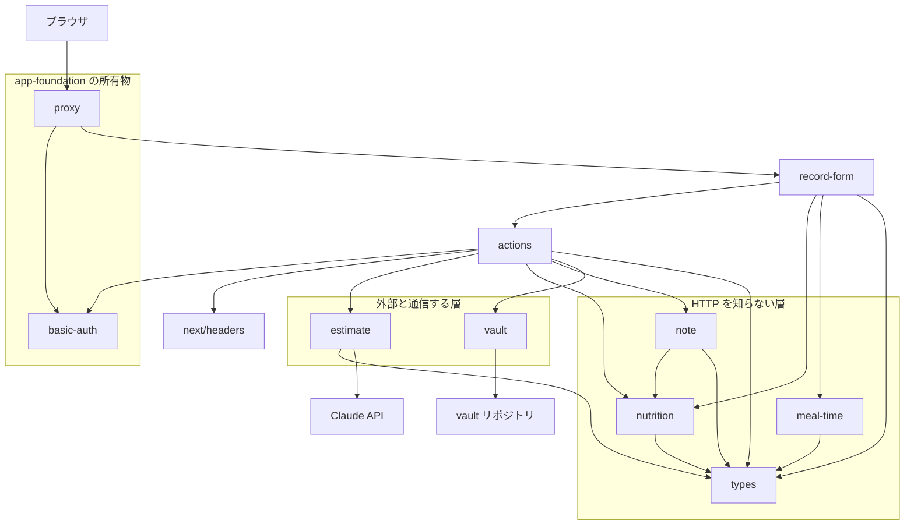
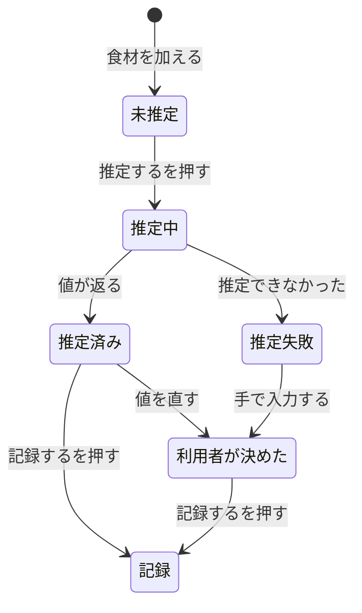

# Technical Design

## Overview

記録画面に「推定する」ボタンを加え、食材名から 100g あたりのカロリーとタンパク質を Claude API で推定する。利用者が入力するのは**食材の名前と量の 2 つ**になる。

推定した値は画面に示され、実感と違えば手で直せる。**直した値は推定し直しても上書きしない。** 記録は値が揃ってから行う。

`meal-record` が作った経路（算出 → 生成 → vault への書き込み）は変更しない。推定は**その手前に挟まる**。推定が出すのは 100g あたりの値であり、そこから先は既存の `calculateItem` / `sumNutrition` / `buildNote` がそのまま受け持つ。

## Goals

- 食材 1 件あたりの入力を 3 項目から 2 項目に減らす（1.2）
- 100g あたりの値を調理前（生）の状態として推定する（2.4）
- **推定できないときは数値を捏造せず、分からないと申告させる**（5.1）
- 推定した値を手で直せるようにし、**直した値を再推定で上書きしない**（3.4）
- 値が揃っていない記録を作らせない（4.5, 4.6）

## Non-Goals

- 推定した値を保存して再利用すること（6.1）— プリセットの spec が扱う
- 外食や人が作ったものの記録 — 生で測れない。写真からの推定として後続の spec が扱う
- 複数の候補を示すこと（2.9）
- 推定の根拠を画面に示すこと（2.8）
- 食材名の正規化 — 入力された表記をそのまま記録に使う方針を引き継ぐ
- 献立単位の記録

## Boundary Commitments

### この spec が所有するもの

- **推定の呼び出しと応答の検証** — `src/lib/estimate.ts`
- **推定の結果を画面の状態に反映する仕組み** — `src/app/record-form.tsx` の拡張
- **推定を求める受付** — `src/app/actions.ts` に加わる Server Action
- 推定に用いる資格情報の読み取り（6.3, 6.4, 6.5）

### Out of Boundary

| 所有しないもの | 所有者 |
|---|---|
| 栄養価の算出（`calculateItem` / `sumNutrition`）と丸めの規則 | `meal-record` |
| ノートの生成（frontmatter 8 項目、ファイル名、引用） | `meal-record` |
| vault への書き込み | `meal-record` |
| 食事区分の推定、日時の扱い | `meal-record` |
| 公開 URL の保護（遮断点） | `app-foundation` |
| 推定した値の保存 | 後続の spec（プリセット） |

### Allowed Dependencies

- `src/lib/estimate.ts` → `src/lib/types.ts` のみ。**`next/*` に依存しない**
- `src/lib/estimate.ts` → `fetch`（外部通信。`vault.ts` と同じ例外）
- `src/app/actions.ts` → `src/lib/estimate.ts`
- `src/app/record-form.tsx` → `src/app/actions.ts`
- **`@anthropic-ai/sdk` を入れない。** `meal-record` と `app-foundation` の design が
  「実行時依存は追加しない。`dependencies` は `next` / `react` / `react-dom` のみ」と定めている

### Revalidation Triggers

次のいずれかが起きたら、影響する箇所を再確認する。

- **`anthropic-version` の値を変える** — 応答の形が変わりうる
- **構造化出力のスキーマ構造を変える** — 文法のキャッシュが無効になり、初回のレイテンシが戻る
- **モデルを変える** — アダプティブ思考の既定、`temperature` を送れるか、構造化出力の対応が変わる
- **推定した値を保存する仕組みを入れる** — 要件 6 の前提が崩れる。プリセットの spec で扱う
- **`stop_reason` の種類が増える** — 現在は `end_turn` 以外を失敗として扱っている

## Architecture



**依存の方向**: `types` → `nutrition` / `meal-time` → `note` → `vault` / `estimate` → `actions` → UI。各層は左側のみを import する。

`estimate` は `vault` と同じ層に置く。どちらも外部 API を呼び、`fetch` を持つ。**`estimate` は `nutrition` に依存しない** — 推定が出すのは 100g あたりの値であり、そこから栄養価を算出するのは `actions` と画面の仕事である。

## File Structure Plan

### Directory Structure

```
src/
├── lib/
│   ├── types.ts             語彙。FoodEstimate を加える
│   ├── nutrition.ts         （変更なし）
│   ├── meal-time.ts         （変更なし）
│   ├── note.ts              （変更なし）
│   ├── vault.ts             （変更なし）
│   ├── estimate.ts          **新規**。Claude API を呼び、応答を検証する
│   └── estimate.test.ts     **新規**。応答の検証を対象にする
└── app/
    ├── actions.ts           推定を求める Server Action を加える
    ├── actions.test.ts      推定の受付の入力検証を加える
    ├── record-form.tsx      「推定する」ボタンと推定の状態を加える
    ├── record-form.test.tsx 推定の求め方・結果の反映・上書きしないことを加える
    └── page.tsx             `maxDuration` を加える
```

`estimate.test.ts` が対象にするのは**応答の検証だけ**である。`fetch` を差し替えて、次を確かめる。

- `content` の先頭が `thinking` ブロックのときに `text` を取り出せるか
- `stop_reason` が `end_turn` 以外のときに失敗として扱うか
- 件数が入力と一致しないときに失敗として扱うか
- `null` を 0 に丸めないか
- 負の値や有限でない値を弾くか

**推定の品質そのものはテストで確かめない。** AI の出力は毎回変わるため、実測で一度確かめる（Testing Strategy を参照）。

### Modified Files

- `src/lib/types.ts` — `FoodEstimate` を加える
- `src/app/actions.ts` — 推定を求める Server Action を加える
- `src/app/record-form.tsx` — 「推定する」ボタンと推定の状態
- `src/app/page.tsx` — `export const maxDuration` を加える
- `.env.local.example` — `ANTHROPIC_API_KEY` を追記する。値は含めない

## Data Models

### 語彙の追加

```typescript
/**
 * 食材 1 件の推定の結果。
 *
 * **`kcalPer100g` と `proteinPer100g` が null になりうる。** 推定できなかった
 * ことを表す。0 で埋めてはならない。0 kcal の食品（水、お茶）と区別が
 * つかなくなり、タンパク質の集計が静かに狂う。
 */
export type FoodEstimate =
  | {
      readonly name: string;
      readonly ok: true;
      readonly kcalPer100g: number;
      readonly proteinPer100g: number;
    }
  | {
      readonly name: string;
      readonly ok: false;
      /** なぜ推定できなかったか。利用者に示す。 */
      readonly note: string;
    };
```

**既存の `FoodInput` は変更しない。** 推定が済んだ食材は `FoodInput` になり、そこから先は既存の経路を通る。

### 画面が持つ状態

```typescript
/**
 * 記録の対象に加えた食材 1 件。
 *
 * `per100g` は**入力欄の文字列**として持つ。数値で持つと入力途中や不正な値を
 * 保持できず、制御された入力欄が勝手に値を戻してしまう。受入基準 3.5 は
 * 「記録を受け付けず、**入力が不正であることを示す**」を求めており、何を直せば
 * よいかを示すには利用者が打った文字列がそのまま残っている必要がある。
 * 「欄が空」と「不正な値」も区別できなくなる。
 *
 * `edited` が true なら利用者が自ら値を決めたので、**推定し直しても
 * 上書きしない**（受入基準 3.4）。
 */
type Per100gInput = {
  readonly kcal: string;
  readonly protein: string;
};

type Entry = {
  readonly id: number;
  readonly name: string;
  readonly grams: number;
  readonly per100g: Per100gInput;
  readonly edited: boolean;
  /** 推定できなかった理由。推定を試みて失敗したときだけ入る。 */
  readonly note: string | null;
};
```

数値への変換は 1 箇所（`readPer100g`）に集める。片方でも読めなければ `null` を返す。
`meal-record` の `parseNumber` を共有するため、受付側との条件のずれが生まれない。

**`edited` が「利用者が自ら決めた」ことの印である。** `meal-record` の `kindChosen`（利用者が食事区分を選んだか）と同じ役割を持つ。あちらは 4.2 の実装で実際に効いた規則であり、同じ構図をここでも使う。

推定の対象は **値が読めない、かつ利用者が直していない食材**である（`readPer100g(per100g) === null && !edited`）。すでに値を持つ食材は、推定由来であっても再推定しない。利用者が「推定する」を 2 回押しても同じ結果になり、通信も無駄にならない。

**`!edited` を条件に含めるのは、含めないと矛盾が生じるため**である。値が読めないことだけを条件にすると、**利用者が欄を空にした食材が対象に戻る**。ところが結果を反映する側は `edited === true` の食材を飛ばすので、結果が捨てられて「押しても何も起きない」窓が開く。対象に入らない形にすることで、利用者が自ら決めたという印が推定の入口と出口の両方で一貫する。

代償として、**欄を空にした食材は「推定する」で埋め直せない**。手で入れ直すか、取り消して加え直すことになる。受入基準 2.3（推定を何度でも求められる）は特定の食材の再推定を求めていないため、これに反しない。

## Components & Interfaces

### 概要

| Component | Domain | Intent | Requirements | 主な依存 |
|---|---|---|---|---|
| 栄養価の推定 | lib | Claude API を呼び、応答を検証して `FoodEstimate` を返す | 2.2, 2.4, 2.5, 2.6, 5.1, 5.6, 6.3, 6.5 | `fetch`, `types` |
| 推定の受付 | app | 画面から食材名を受け、推定を返す | 2.2, 4.1, 6.4, 6.5 | `estimate`, `basic-auth`, `next/headers` |
| 記録フォーム | app | 推定を求め、結果を反映し、修正を受ける | 1.1〜1.7, 2.1, 2.3, 2.7, 3.1〜3.6, 4.1〜4.6, 5.1〜5.5 | `actions`, `nutrition`, `meal-time` |

### lib 層

#### 栄養価の推定

**Responsibilities**

- 食材名の一覧を受け、100g あたりのカロリーとタンパク質を推定する
- **応答を検証する。** 件数・値の妥当性・`stop_reason` を確かめる
- 失敗の原因を分類する

**Dependencies**

- Outbound (P0): Claude Messages API — `POST https://api.anthropic.com/v1/messages`
- Outbound (P2): `src/lib/types.ts`
- External (P0): `fetch`

**Contracts**: Service / API

**Service Interface**

```typescript
export type EstimateConfig = {
  readonly apiKey: string;
};

/**
 * 推定に使う資格情報を環境変数から読む。
 *
 * 設定が揃っていなければ null を返す。**呼び出し側は null のとき
 * 推定を試みない**（受入基準 6.5）。
 */
export function loadEstimateConfig(
  env: Record<string, string | undefined>,
): EstimateConfig | null;

export type EstimateFailure =
  /** 通信できなかった。再送で直りうる。 */
  | "network"
  /** 資格情報が無効。利用者が再送しても直らない。 */
  | "credential"
  /** 応答が期待した形でなかった。 */
  | "malformed";

export type EstimateResult =
  | { readonly ok: true; readonly estimates: readonly FoodEstimate[] }
  | { readonly ok: false; readonly reason: EstimateFailure };

/**
 * 食材名から 100g あたりの値を推定する。
 *
 * 返る配列は**入力と同じ順序・同じ件数**である。件数が合わない応答は
 * `malformed` として扱う（スキーマで件数を縛れないため）。
 *
 * 個々の食材が推定できなかった場合は `ok: true` のまま、その要素が
 * `FoodEstimate` の `ok: false` になる。**全体の失敗と個別の失敗は別である。**
 */
export function estimate(
  config: EstimateConfig,
  names: readonly string[],
): Promise<EstimateResult>;
```

**Preconditions**

- `names` は 1 件以上。空配列では呼ばない
- 各要素は空文字でない

**Postconditions**

- `ok: true` のとき `estimates.length === names.length` かつ順序が一致する
- `ok: true` の各要素について、`ok: true` なら `kcalPer100g` と `proteinPer100g` は**有限の非負数**
- **`null` を 0 に変換しない**

**API Contract**

| 項目 | 値 |
|---|---|
| Method / Path | `POST https://api.anthropic.com/v1/messages` |
| Headers | `x-api-key` / `anthropic-version: 2023-06-01` / `content-type: application/json` |
| Model | `claude-haiku-5-5` |
| Body | `model` / `max_tokens` / `system` / `messages` / `output_config.format` |

**`anthropic-version` は `2023-06-01` を送る。** 存在する値はこれと `2023-01-01`（deprecated）の 2 つだけで、日付を上げる必要はない。API リファレンスのヘッダ表は optional と書いているが versioning のページは必須と書いており、**記述が食い違っているので常に送る**。

**`temperature` / `top_p` / `top_k` は送らない。** Haiku 5.5 では既定値以外を送ると 400 になる。

構造化出力のスキーマ:

```json
{
  "type": "json_schema",
  "schema": {
    "type": "object",
    "properties": {
      "items": {
        "type": "array",
        "items": {
          "type": "object",
          "properties": {
            "name":    { "type": "string" },
            "kcal":    { "anyOf": [{ "type": "number" }, { "type": "null" }] },
            "protein": { "anyOf": [{ "type": "number" }, { "type": "null" }] },
            "note":    { "type": "string" }
          },
          "required": ["name", "kcal", "protein", "note"],
          "additionalProperties": false
        }
      }
    },
    "required": ["items"],
    "additionalProperties": false
  }
}
```

**`kcal` と `protein` を nullable にすることが「分からないと言わせる」仕掛けそのものである。** 構造化出力は文法制約サンプリングなので、`null` を合法な出力にしておけば**モデルが数値を出すしかない状況を作らずに済む**。プロンプトだけの指示より強い。

トップレベルを配列にできるかは公式に記述がないため、`{ items: [...] }` のオブジェクトで包む。

**Error Handling**

| 応答 | 分類 | 根拠 |
|---|---|---|
| `fetch` が throw（abort を含む） | `network` | 通信できていない |
| `500` / `504` / `529` | `network` | 一時的。再送で直りうる |
| `429` | `network` | レート制限。時間を置けば直る |
| `401` / `402` / `403` | `credential` | キーが無効・課金の問題・権限の不足。**再送では直らない** |
| `400` / `413` | `malformed` | アプリが組んだ要求が不正。利用者には対処できない |
| `stop_reason` が `end_turn` 以外 | `malformed` | 拒否または出力の打ち切り |
| `content` に `text` が無い | `malformed` | — |
| `JSON.parse` が throw | `malformed` | — |
| 件数が入力と一致しない | `malformed` | スキーマで縛れない |
| 値が有限の非負数でない | その食材を `ok: false` にする | 全体を失敗にしない |

**`401` / `402` / `403` を 1 つにまとめない。** `vault.ts` は GitHub API 向けに 401/403 をまとめているが、Claude API では 401 = キー自体が無効、402 = 課金の問題、403 = 権限の不足と意味が違う。残高切れを「キーが無効」と表示すると原因が分からなくなる。ただし**利用者から見た対処は同じ**（開発者に伝える）なので、画面には `credential` として 1 つの文面で示す。分類はログのためである。

**Implementation Notes**

- **`content[0]` を読んではいけない。** Haiku 5.5 はアダプティブ思考が既定 ON で、`content` の先頭に text が空の `thinking` ブロックが入りうる。`content.find((b) => b.type === "text")?.text` で型を絞る
- **`stop_reason` を `content` より先に見る。** 拒否は **HTTP 200** で返り、`stop_reason: "refusal"` になる。見落とすと `content` が空のまま進む
- **`fetch` に `signal: AbortSignal.timeout(...)` を付ける。** Vercel Hobby のタイムアウトは 300 秒あるので切られる心配はないが、本当のリスクは**ハングしたリクエストを利用者が待たされる**ことである。abort も `fetch` が throw するので `network` に落ちる
- **失敗時に応答をそのままログに出さない。** 要求のヘッダに API キーが含まれるため
- `note` に段階的な理由を要求しない。公式が「スキーマのフィールドで step-by-step の推論を要求すると `reasoning_extraction` カテゴリの refusal を引き起こしうる」と明記している。**1 行の短い説明にとどめる**

**システムプロンプト**

```
あなたは食品の栄養価を推定する。入力された食材名ごとに、
調理前（生）の状態の可食部 100g あたりのエネルギー（kcal）と
たんぱく質（g）を推定する。

- 値は調理前（生）の可食部 100g あたりとする。ゆでる・焼く・揚げるなどの
  調理による重量や成分の変化は反映しない。
- 「鶏もも」のように皮の有無が書かれていない場合は、一般に流通している
  状態（皮つき）を仮定し、その仮定を note に 1 行で書く。
- 米など生の状態で食べない食材も、生（乾物）の状態の 100g あたりで答える。
  炊飯後の値は答えない。
- 食材名が具体的な食品を特定できないほど曖昧な場合（例: 「肉」「野菜」
  「惣菜」）、および自信を持って推定できない場合は、kcal と protein を
  null にし、note に理由を 1 行で書く。
  推測で数値を埋めてはならない。分からないことを申告するほうが
  間違った数値を返すよりはるかに望ましい。
- note は 1 行の短い説明にとどめる。推論の過程は書かない。
- 入力された食材は、順序と件数を変えずにすべて返す。
```

### app 層

#### 推定の受付

**Responsibilities**

- 画面から食材名の一覧を受け、推定を返す
- 認証を再検証する（多層防御）
- 資格情報の有無を判定する

**Dependencies**

- Inbound (P0): 記録フォーム
- Outbound (P0): `src/lib/estimate.ts`
- Outbound (P1): `src/lib/basic-auth.ts` — 多層防御の 2 層目
- Outbound (P1): `next/headers`

**Contracts**: Service

**Service Interface**

```typescript
export type EstimateState =
  | { readonly status: "idle" }
  | { readonly status: "success"; readonly estimates: readonly FoodEstimate[] }
  | {
      readonly status: "error";
      readonly reason: "invalid" | "unauthorized" | "config" | EstimateFailure;
    };

/**
 * 推定を求める。
 *
 * 処理の順序は **入力の検証 → 認証の再検証 → 資格情報 → 推定** である。
 * `meal-record` の `recordMeal` と同じ順序にしてある。
 */
export function estimateFoods(
  previous: EstimateState,
  formData: FormData,
): Promise<EstimateState>;
```

**送信する項目**

| 項目名 | 内容 |
|---|---|
| `name` | 食材名。**推定が必要な食材の分だけ**繰り返す |

**量を送らない。** 推定は 100g あたりの値を返すので、量は不要である。画面が持っていればよい。

**Implementation Notes**

- **`basic-auth` の検証を推定の前に置く。** `app-foundation` の design.md が「`matcher` の変更や Server Function を別ルートへ移すリファクタによって保護が静かに外れうる。その関数の内部でも認証を検証すること」と要求している。`recordMeal` と同じ構図である
- 資格情報が設定されていなければ**推定を試みずに** `config` を返す（受入基準 6.5）
- `reason: "config"` の戻り値に**変数名を含めない**。画面が静的な文面として示す。資格情報に関わる情報を戻り値に載せないため

#### 記録フォーム

**Responsibilities**

- 食材の名前と量を受ける（100g あたりの値は求めない）
- 推定を求め、結果を状態に反映する
- 推定した値の修正を受け、**修正した値を再推定で上書きしない**
- 値が揃っていない食材があるとき記録を受け付けない

**Dependencies**

- Inbound (P0): `src/app/page.tsx`
- Outbound (P0): `src/app/actions.ts`
- Outbound (P1): `src/lib/nutrition.ts` / `src/lib/meal-time.ts`

**Contracts**: State

**状態の遷移**



**「推定する」の対象は、値が読めず利用者も直していない食材だけである。** すでに値を持つ食材は、推定由来でも利用者が直した値でも、再推定しない。これにより受入基準 3.4（修正した値を上書きしない）が構造的に満たされる。

**Validation**

「記録する」を無効にする条件:

- 食材が 0 件（4.4）
- **値が読めない食材が 1 件でもある**（4.5）
- 時刻が空（`meal-record` の 4.2 で確定した条件）
- 推定中（4.3）
- 記録中

「推定する」を無効にする条件:

- 食材が 0 件（4.4）
- **推定の対象が 0 件**（値が読めず利用者も直していない食材がない）
- 推定中（4.2）

**Implementation Notes**

- **`<form action={formAction}>` を使わない。** `meal-record` の 4.3 で確定した判断である。`action` に関数を渡すと React が送信後に `form.reset()` を呼び、`<select>` が `value` で制御されていても先頭の選択肢に戻ったまま復元されない。`onSubmit` で `FormData` を組み、`startTransition` の中で `formAction` を呼ぶ
- 推定の結果を反映するとき、**`edited === true` の食材を飛ばす**。推定を求めた時点では対象だった食材を、**待っているあいだに利用者が直した**場合に効く。
  **このガードは「`per100g` が埋まる経路は利用者の修正だけ（必ず `edited` を立てる）」という前提に依存している。** プリセットのように `edited` を立てずに値を埋める経路ができると、静かに効かなくなる
- **値が揃っていない食材を画面で示す**（4.6）。示さないと「なぜか記録できない」状態になる
- 推定できなかった食材には `note` を添える。モデルが返した理由をそのまま出す
- 既存の規則を壊さない: 下書き行に項目名を付けない（4.1）/ 0 埋め（4.2）/ 区分の保持（4.2）/ 成功後のクリア（6.2）

## Error Handling

| 分類 | 画面に示すこと |
|---|---|
| `network` | 通信できなかったこと。**時間を置いてやり直せる**ことが分かる文面 |
| `credential` | 推定に使う資格情報に問題があること。**利用者には対処できない**ので、開発者に伝えるべきことが分かる文面 |
| `malformed` | 推定の応答が期待した形でなかったこと。やり直せることが分かる文面 |
| `config` | 設定が不足していること。**不足しうる変数名を画面が静的に示す**（`ANTHROPIC_API_KEY`） |
| `invalid` | 入力が不正であること |
| `unauthorized` | 通常は遮断点が先に 401 を返すため目にしない。**表に出たら遮断点の適用範囲が壊れている兆候**である旨が分かる文面 |
| 個別の食材が `ok: false` | **どの食材か**と、モデルが返した理由。その食材だけ手入力に切り替えられる |

**個別の失敗と全体の失敗を分ける。** 1 件だけ推定できなかったときに全体を失敗にすると、推定できた食材の値も失われる（受入基準 5.5 に反する）。

## Testing Strategy

### Unit Tests

純粋関数と、画面の振る舞いのうち機械的に確かめられるものを対象とする。

1. `loadEstimateConfig` が `ANTHROPIC_API_KEY` の有無で設定または null を返す（6.5）
2. 応答の `content` の先頭が `thinking` ブロックでも `text` を取り出せる（2.2）
3. `stop_reason` が `end_turn` 以外のとき `malformed` を返す（5.6）
4. 件数が入力と一致しない応答を `malformed` として扱う（2.2）
5. `kcal` が `null` の要素を `ok: false` として返し、**0 に丸めない**（5.1）
6. 負の値や有限でない値を含む要素を `ok: false` として返す（2.6）
7. `401` / `402` / `403` を `credential`、`429` / `500` / `504` / `529` を `network` に分類する（5.6）
8. `fetch` の throw（abort を含む）を `network` に分類する（5.6）
9. 入力と同じ順序で結果を返す（2.2）

画面側（`record-form.test.tsx`）:

10. 100g あたりの値の入力欄が無い（1.2）
11. 「推定する」を押すと、**値を持たない食材の名前だけ**が受付に渡る（2.2）
12. 推定の結果が食材ごとに反映され、合計が出る（2.7）
13. **値を手で直したあと「推定する」を押しても、直した値が変わらない**（3.4）
14. 推定中は「推定する」と「記録する」のいずれも押せない（4.2, 4.3）
15. 値を持たない食材があるとき「記録する」が押せず、**どの食材か示される**（4.5, 4.6）
16. 推定できなかった食材が示され、手で入力できる（5.1, 5.2）
17. 一部だけ推定できなかったとき、**推定できた食材の値が残る**（5.5）

### 外部 API の検証は実測で行う

`estimate.ts` のうち `fetch` を呼ぶ部分は単体テストで意味のある検証ができない。`meal-record` の `vault.ts` と同じく実測で担保する。

### 実測で潰す前提（タスク 1.1 / 1.2 で行う）

`meal-record` で GitHub API の応答を実測して「重複は 422（409 ではない）」を確定させたのと同じ工程である。

**本 spec では `ANTHROPIC_API_KEY` が環境に無いため、設計の段階で実施できなかった。** タスク 1.1 と 1.2 で行う。**1.1 の結果によって本設計が変わりうる** — 曖昧な名前で `null` が返らない場合は、プロンプトの作り直しか、候補を複数出させて食い違いを検知する別の仕掛けが必要になる。その判定を 1.1 の完了条件に入れてある。

| 確かめること | なぜ必要か |
|---|---|
| **「肉」「野菜」のような曖昧な名前で `null` が返るか** | 黙って平均値を返されるのが最悪の失敗。プロンプトとスキーマの仕掛けが実際に効くかは実測しないと分からない。**本 spec でいちばん重要な未検証事項** |
| 食材 4 件の推定にかかる実時間 | 公式は相対順位（Fastest / Fast）しか公開していない。待ち時間の設計に必要 |
| 代表的な食材 10 件の誤差 | 日本食品標準成分表の値と比べ、幅（±20% 程度）に入るか |
| `effort: "low"` + 思考 OFF と既定（`medium`）の比較 | 速度と精度のどちらを採るかの判断材料 |

### 手作業での確認

1. 食材名と量だけを入れて「推定する」を押し、値と合計が出る
2. 値を手で直し、合計が変わる
3. **食材を足して「推定する」を押し、直した値が変わらない**
4. 曖昧な食材名を入れ、推定できないことが示され、手で入力できる
5. `ANTHROPIC_API_KEY` を外して起動し、**推定を試みずに**設定の不足が示される
6. 推定中に「記録する」が押せない
7. 値が揃っていない食材があるとき、どの食材か示される
8. 記録が vault に届き、frontmatter 8 項目が揃う

## Security Considerations

- **API キーはサーバー側の環境変数に置き、クライアントに渡さない**（6.3, 6.4）。`estimate.ts` は `src/lib/` にあるが `process.env` を直接読まず、**引数で受ける**（`vault.ts` と同じ）
- **戻り値に資格情報を載せない。** `reason: "config"` のとき変数名は画面が静的に示す
- **失敗時に API の応答をそのままログに出さない。** 要求のヘッダにキーが含まれる
- **多層防御**: 推定の受付でも認証を再検証する。`app-foundation` の申し送りに従う
- 推定した値を保存しないため、食材のデータが蓄積されることはない（6.1）

## Performance Considerations

- Haiku 5.5 は 10 万トークン以下なら $0.10 / $0.50 per MTok。1 回約 $0.00034（0.05 円）、月 120 回で 6 円程度。**コストは論点にならない**
- `page.tsx` に `export const maxDuration` を置く。Server Action は専用の上限を持たず、**それが属するページの `maxDuration`** に従う。Vercel Hobby の既定は 300 秒だが、**暴走を 5 分放置するより早く失敗させる**
- `fetch` に `AbortSignal.timeout(...)` を付ける。ハングを利用者に待たせない
- プロンプトキャッシュは期待しない。Haiku 5.5 の最小長は 512 トークンで、システムプロンプトが短いため効かない
- 構造化出力のスキーマは文法にコンパイルされ 24 時間キャッシュされる。初回のみ遅い

## Requirements Traceability

| Requirement | Summary | Components | Interfaces |
|---|---|---|---|
| 1.1, 1.3, 1.6, 1.7 | 名前と量の入力、複数の食材、取り消し | 記録フォーム | `Entry` |
| 1.2 | 100g あたりの入力を求めない | 記録フォーム | — |
| 1.4, 1.5 | 空の名前・不正な量を弾く | 記録フォーム / 推定の受付 | — |
| 2.1, 2.3 | 推定を求める手段、何度でも | 記録フォーム | — |
| 2.2 | 値を持たない食材を推定する | 栄養価の推定 / 推定の受付 | `estimate` |
| 2.4, 2.5 | 調理前の状態、名前をそのまま使う | 栄養価の推定 | システムプロンプト |
| 2.6 | 小数を含められる | 栄養価の推定 | `FoodEstimate` |
| 2.7 | 値・食材ごと・合計を示す | 記録フォーム | `calculateItem` / `sumNutrition` |
| 2.8, 2.9 | 根拠を示さない、候補は 1 つ | 栄養価の推定 | スキーマ |
| 3.1〜3.3, 3.5, 3.6 | 修正と算出し直し | 記録フォーム | `Entry.per100g` |
| 3.4 | **修正した値を上書きしない** | 記録フォーム | `Entry.edited` |
| 4.1〜4.4 | 推定中の提示、受け付けの抑止 | 記録フォーム | `EstimateState` |
| 4.5, 4.6 | 値が揃うまで記録しない、どの食材か示す | 記録フォーム | `Entry.per100g` |
| 5.1, 5.2 | どの食材が推定できなかったか、手入力 | 栄養価の推定 / 記録フォーム | `FoodEstimate` |
| 5.3 | 手入力した値で記録する | 記録フォーム | `Entry.edited` |
| 5.4, 5.5 | 入力の保持、推定できた値の保持 | 記録フォーム | `Entry` |
| 5.6 | 原因が通信か食材名か | 栄養価の推定 | `EstimateFailure` |
| 6.1, 6.2 | 値を保存しない、毎回推定する | 栄養価の推定 | — |
| 6.3, 6.4, 6.5 | 資格情報の扱い | 栄養価の推定 / 推定の受付 | `loadEstimateConfig` |

## Open Questions / Risks

- **曖昧な食材名で黙って平均値を返す可能性** — スキーマとプロンプトの仕掛けは用意したが、Haiku 5.5 が実際に `null` を返すかは**ドキュメントからは判断できない**。実測で確かめる。これが本 spec でいちばん大きなリスクである
- **推定の品質が落ちても気づけない** — AI の出力は毎回変わるため自動テストにできない。利用者が値を見て気づくことになる。**受け入れた制約である**
- **日本語の食材名での精度が不明** — 公式に日本食品標準成分表との一致度に関する情報はない
- **待ち時間が実測できていない** — 公式は相対順位しか公開していない。遅ければ `effort: "low"` に下げる判断がある
